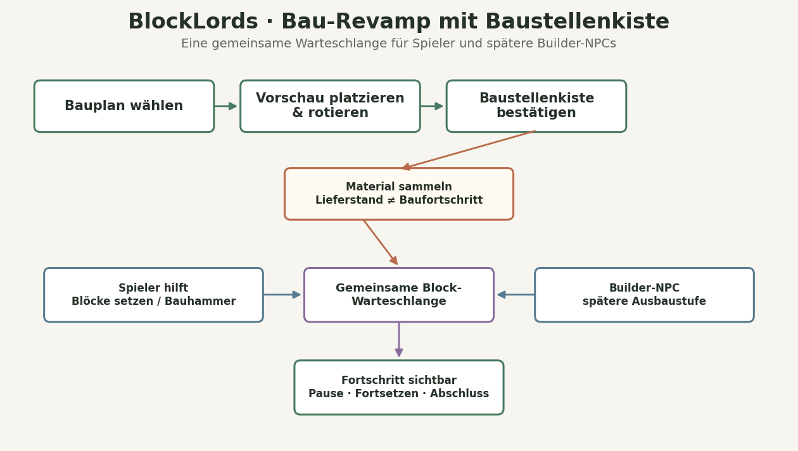

# BlockLords — Deep Research und Bau-Revamp

**Datum:** 23.11.2026  
**Auslöser:** Bus-Ticket #202 sowie Alexanders Vorschlag einer Kiste am Gebäude zur Informationsanzeige und aktiven Bauhilfe  
**Ziel:** Eine technisch robuste, spielerfahrungsorientierte Zielarchitektur für Vorschau, Platzierung, Baustellen, NPC-Bau und aktive Mitwirkung. Dieses Dokument ist eine Entscheidungsvorlage; es enthält noch keine Codeänderung.

## Executive Summary

Die zentrale Empfehlung lautet: **Jede Baustelle erhält eine echte, geschützte Baustellenkiste als physischen Anker.** Die Kiste markiert den Bauplan, hält die gelieferten Materialien und öffnet ein Menü mit benötigten, gelieferten und tatsächlich verbauten Ressourcen. Sie bleibt während des gesamten Bauens bestehen und wird nach Abschluss zu einem Informations- und Restmaterialpunkt. Die Vorschau wird clientseitig gerendert und besitzt serverseitig einen eigenen Session-Zustand; bei der Bestätigung wird die Welt validiert und die Preview korrekt geschlossen. Spieler können fehlende Blöcke entweder nur liefern, selbst in die Vorschau setzen oder mit einem Bauhammer gezielt aus der gemeinsamen Block-Warteschlange platzieren. Ein späterer Builder-NPC verwendet exakt dieselbe Warteschlange und denselben Kistenbestand, sodass keine getrennte oder konkurrierende Wirtschaft entsteht.

Dieses Modell beantwortet gleichzeitig den Preview-Confirm-Fehler, den unsichtbaren Baufortschritt, die dünne Diagnose und Alexanders Kistenidee. Die Architektur trennt **Lieferstand** von **Baufortschritt**, verwendet Sponge-Schematics mit explizitem Anker und rotationsfähigem ClipboardHolder und behandelt die echte Welt sowie den Kisteninhalt als maßgebliche Bestände. FAWE wird für Schematic-Verarbeitung und kontrollierte Batches eingesetzt, während einzelne Spieler-/NPC-Platzierungen im korrekten Spielkontext erfolgen. Die Umsetzung beginnt mit einem kleinen Diagnose- und Bugfix-Paket; die neue Baustellenarchitektur folgt erst danach in klar abgegrenzten Schritten.

## 1. Befunde aus Ticket #202 und aktuellem Code

### 1.1 B1 — Preview blockiert die eigene Bestätigung

Der aktuelle Ablauf erzeugt eine Vorschau mit `sendBlockChange`, speichert Originaldaten und prüft bei `confirmPreview` erneut jede Zielposition mit `block.getType().isAir()`. Dabei wird die vorhandene Preview weder vor der Prüfung geschlossen noch als eigene Position ausgenommen. Paper dokumentiert ausdrücklich, dass diese Block-Updates nur den Client täuschen und die Welt nicht verändern; die Bestätigung darf deshalb nicht vom sichtbaren Clientzustand ausgehen, sondern muss die serverseitige Preview-Session kontrolliert beenden und anschließend die reale Welt validieren ([PaperMC](https://jd.papermc.io/paper/26.3/org/bukkit/entity/Player.html)).

Die sofortige Reparatur braucht zwei unabhängige Schutzlinien: Erstens wird vor dem Bestätigen die Preview mit denselben Originaldaten zurückgesetzt und danach die Welt erneut geprüft. Zweitens ignoriert die Kollisionsprüfung bei einer aktiven Preview ausschließlich deren eigene registrierte Positionen; neue oder fremde Blöcke bleiben weiterhin blockierend. Die spätere Baustellenkiste ersetzt diesen Sonderfall durch einen sauberen Zustandsübergang `PREVIEW → COLLECTING`. Ein manuelles Abbauen der Preview ist weder als Workaround noch als Dauerlösung akzeptabel.

### 1.2 B2 — Selftest bleibt auf Paper 26.3 stumm

Auf Paper 1.21.11 erzeugte derselbe Baupfad nachweislich 99 Blöcke; auf Paper 26.3 fehlen Blöcke, Erfolg und Fehlermeldung. FAWE verarbeitet Edits asynchron über lokale und globale Chunk-Queues, während `Operations.complete` und `EditSession.close` blockierende Abschlusspunkte sind. Die Dokumentation nennt Chunk-Ladeprobleme als mögliche Stillstandsursache ([FAWE](https://github.com/IntellectualSites/documentation/blob/main/fastasyncworldedit/configuration/configuration.md), [FAWE API](https://intellectualsites.gitbook.io/fastasyncworldedit/api/api-usage)). Ein reines Erfolg-/Fehler-Callback reicht deshalb nicht, wenn weder Start noch Queue-Zustand noch Abschluss sichtbar sind.

Vor einer Verhaltensänderung werden strukturierte Diagnosepunkte eingeführt: Befehl angenommen, Welt aufgelöst, betroffene Chunks geprüft, EditSession erstellt, Blöcke eingereiht, Flush begonnen, EditSession geschlossen, Callback empfangen. Jede Diagnose erhält eine eindeutige Aktions-ID und meldet Dauer, Welt, Koordinaten und Blockanzahl. Fehler werden immer mit Stacktrace geloggt; Erfolg und Timeout erscheinen sowohl im Log als auch beim Auslöser. Erst mit diesen Messpunkten lässt sich belegen, ob B2 aus Chunk-Ladung, Threading, FAWE-Queue oder verlorenem Callback entsteht.

### 1.3 B3/B4 — Audit und Logging

Der Audit-Befund widerspricht dem erwarteten Verhalten, weil Gründung, Baustellen und Adminaktionen bereits `AuditService.log(...)` aufrufen. Der Fehler ist ohne Auslesen der SQLite-Tabelle und Prüfung des DB-Executor-Ablaufs nicht sicher lokalisiert. Die Reparatur muss deshalb eine Schreib-Lese-Probe enthalten: einen bekannten Testeintrag schreiben, dessen ID zurückgeben und denselben Datensatz über `/bl admin audit` wiederfinden. Zusätzlich werden Repository-Fehler sichtbar geloggt, statt nur eine leere Liste anzuzeigen. Audit ist fachliche Chronik und nicht mit Debug-Logging gleichzusetzen.

Das Logniveau wird konfigurierbar: `INFO` für Start, Gründung, Bauabschluss und Backup; `DEBUG` für Preview-Pakete, DB-Details und Fortschritts-Ticks; `ERROR` für jeden Fehler. Normale Produktion darf den Serverlog nicht dauerhaft fluten. Technische Diagnose und Spielerfeedback verwenden dieselbe Aktions-ID, sodass Axon eine Meldung im Spiel eindeutig einer Logfolge zuordnen kann. MockBukkit eignet sich für Befehls-, Event- und Zustandstests; FAWE bleibt auf dem echten Integrationsserver zu testen ([MockBukkit](https://github.com/Mockbukkit/Mockbukkit)).

## 2. Was die Recherche für das Zielbild belegt

### 2.1 Preview und Platzierung

Papers Multi-Block-Updates fälschen mehrere Blöcke je Chunk-Sektion und verändern die Welt nicht; für nicht geladene Client-Chunks wird keine Funktionsgarantie gegeben ([PaperMC](https://jd.papermc.io/paper/26.3/org/bukkit/entity/Player.html)). WorldEditCUI ist dagegen ein Plugin-Channel zu einem optionalen Clientmod und keine geeignete Pflichtlösung für Java plus Bedrock ([Minecraft Wiki](https://minecraft.wiki/w/Java_Edition_protocol/Plugin_channels/WorldEditCUI)). Die Hauptpreview verwendet daher Papers Block-Updates; Partikel oder Display-Entities markieren Origin, Eingang und Grenzen als redundante, leicht sichtbare Führung. Eine zusätzliche PacketEvents-Abhängigkeit wird nur erwogen, wenn ein reproduzierbarer Clientfehler auf Paper/Geyser damit nicht lösbar ist.

Sponge `.schem` v3 unterstützt Blockstates, Block-Entities, Entities und einen relativen Offset ([Sponge](https://github.com/SpongePowered/Schematic-Specification/blob/master/versions/schematic-3.md)). WorldEdit/FAWE übernimmt Rotationen über den ClipboardHolder vor dem Erzeugen der Paste-Operation ([WorldEdit](https://worldedit.enginehub.org/en/latest/api/examples/clipboard/)). Jeder BlockLords-Bauplan erhält neben der Datei deshalb Metadaten für Anker, Eingang, Baustellenkiste, Job-Sites, Größe und Baukosten. Die Platzierung beginnt am vom Spieler anvisierten Boden, nicht automatisch über der Glocke. Verschieben und Rotieren müssen denselben transformierten Blockplan verwenden; Türen, Betten und Arbeitsplätze dürfen nicht nur optisch, sondern auch funktional rotiert werden.

### 2.2 Baustellenkiste und Fortschritt

Alexanders Kistenidee entspricht einem bereits erprobten Muster: Ein dediziertes Builder-Chest-Plugin kombiniert Vorschau, Bestätigung, animierten Bau, Fortschrittsanzeige und Undo ([ArcaneBuilder](https://www.spigotmc.org/resources/arcanebuilder-%E2%9A%A1-cinematic-building-animated-schematics-preview-claim-protections-undo-%E2%9A%A1.134753/)). MineColonies geht weiter und unterscheidet gelieferte von tatsächlich verwendeten Ressourcen, zeigt fehlende Materialien und unterstützt Prioritäten sowie fortsetzbare Arbeitsaufträge ([MineColonies](https://minecolonies.com/wiki/buildings/builder/)). Diese Trennung ist für BlockLords verbindlich: `geliefert/gesamt` beantwortet die Materialfrage, `verbaut/gesamt` beantwortet den tatsächlichen Fortschritt.

Die Kiste wird dadurch nicht nur GUI-Icon, sondern physischer Arbeitsort. Spieler erkennen an ihrem Namen und einer kleinen Hologramm-/Partikelanzeige den aktuellen Zustand. Das Menü bietet „fehlende Items aus Inventar abgeben“, „aus Rathaus-Vorrat entnehmen“, „Bau pausieren/fortsetzen“ und nach Abschluss „Restmaterial zurücknehmen“. Der Kisteninhalt bleibt dabei real und nachvollziehbar; es gibt keine zweite, davon abweichende virtuelle Materialliste. Die Datenbank speichert Baustellenzustand und Beitragsanerkennung, während der Kisteninhalt und die Welt die tatsächlichen Bestände liefern.

### 2.3 Aktive Mitwirkung und NPC-Integration

Litematica zeigt, wie eine Vorschau korrekt gesetzte Blöcke erkennt, Materiallisten führt und Fehlstellen markiert ([Litematica](https://github.com/Michaelangel007/litematica_instructions)). BlockLords übernimmt dieses Prinzip serverseitig: Wenn ein Spieler einen vorgesehenen Block korrekt setzt, wird die Position als erledigt markiert, der Beitrag registriert und der Block aus der verbleibenden Warteschlange entfernt. Für schwer erreichbare oder auf Mobilgeräten ungenau anvisierbare Positionen bietet der Bauhammer eine begrenzte Alternative: Rechtsklick auf die Baustellenkiste oder eine markierte Position setzt genau den nächsten gültigen Block, sofern Material vorhanden ist. Eine kurze Cooldown verhindert Klick-Spam; jede Aktion erzeugt echten Fortschritt.

Idle-Game-Forschung beschreibt, dass sichtbare Reaktionen auf Spielerinteraktion Kontrolle und Zufriedenheit stärken können ([eScholarship](https://escholarship.org/content/qt0b07v51w/qt0b07v51w.pdf)). Daraus wird jedoch kein Clicker-System abgeleitet. Aktive Bauhilfe bleibt eine Entscheidung zwischen selbst setzen, Material organisieren oder auf einen späteren NPC-Bauer warten. Die NPC-Arbeit ist keine unsichtbare Pflichtfalle: Vanilla-Job-Sites besitzen eigene Beanspruchungs- und Erreichbarkeitsregeln sowie visuelle Signale ([Minecraft Wiki](https://minecraft.wiki/w/Villager)). BlockLords zeigt „verknüpft“, „nicht erreichbar“ oder „frei“ im Arbeiter-Menü, berechnet Produktion und Baufortschritt aber weiterhin robust über die registrierte Zuordnung.

### 2.4 Kooperation und Zustandsdisziplin

Die Minecraft-Forschung zur Architect-/Builder-Zusammenarbeit zeigt den Wert klarer Rollen und gemeinsamer Zielstrukturen ([University of Illinois](https://juliahmr.cs.illinois.edu/Minecraft/)). BlockLords darf dabei den Landherrn nicht zum einzigen interessanten Akteur machen. Der Landherr wählt Bauplan und Priorität; Bürger liefern Material oder setzen Blöcke; Gefolgsleute pausieren und verwalten den Auftrag. Die Baustellenkiste zeigt Beiträge ohne öffentliche Beschämung und ohne Rangliste, die langsame Spieler bestraft.

Die Zustandsmaschine ist verbindlich: `ENTWURF → VORSCHAU → SAMMELN → BEREIT → BAUEN → ABGESCHLOSSEN`, mit `PAUSIERT` und `ABGEBROCHEN` als kontrollierten Seitenpfaden. MineColonies-Fehlerberichte über veraltete Auftrags- und Materiallisten nach Abbruch zeigen, warum Ziel, Status und Material nicht getrennt alt bleiben dürfen ([MineColonies Issue](https://github.com/ldtteam/minecolonies/issues/11215)). Beim Abbruch vor Baubeginn bleiben alle Items in der Kiste. Während des Bauens bleiben bereits gesetzte Blöcke stehen; Restmaterial bleibt ebenfalls in der Kiste. Ein vollständiges Undo ist nur ein späterer Admin-/Spezialfall mit gesichertem Snapshot, keine reguläre Pflichtfunktion.

## 3. Verbindliches Zielkonzept für das Bau-Revamp



### 3.1 Ablauf aus Spielersicht

| Schritt | Spielerhandlung | Sichtbare Systemantwort |
|---|---|---|
| **Bauplan wählen** | Rathaus/Glocke → „Bauen“ → Bauplan | Name, Größe, Kosten, Freischaltbedingungen und Eingang werden angezeigt |
| **Position bestimmen** | Boden anvisieren | Vorschau erscheint am gewählten Ort; Origin und Eingang sind markiert |
| **Ausrichten** | Neuen Boden wählen oder Rotationsaktion verwenden | Gleicher Blockplan wird verschoben/rotiert; Kollisionen werden sofort markiert |
| **Bestätigen** | Vorschau-Menü → „Baustellenkiste platzieren“ | Preview schließt, reale Welt wird validiert, Kiste entsteht am definierten Anker |
| **Material liefern** | Kiste öffnen und Inventar beitragen oder Vorrat verwenden | Lieferstand und fehlende Ressourcen aktualisieren sich sofort |
| **Aktiv helfen** | Vorgesehene Blöcke selbst setzen oder Bauhammer verwenden | Fortschritt springt sichtbar weiter; Beitrag wird auditierbar anerkannt |
| **Automatisieren** | Später Builder-NPC zuweisen | NPC verbraucht dieselbe Kiste und dieselbe verbleibende Block-Warteschlange |
| **Pausieren/fortsetzen** | Kiste → Auftragssteuerung | Kein Blockverlust, keine veraltete Materialliste; Welt und Kiste bleiben konsistent |
| **Abschließen** | Letzter Block und Abschlussprüfung | Fertigmeldung, Dorf-XP, Beitragsliste und Restmaterialzugriff |

Die Kiste bleibt nach Abschluss zunächst als Informations- und Restmaterialpunkt stehen. Landherr oder Gefolgsmann kann sie nach Leerung geordnet entfernen. Beim Entfernen werden keine Items gelöscht. Diese Regel macht die Kiste zu einem verständlichen physischen Bestandteil des Dorfes, statt nach dem Bau ein unsichtbares Objekt zu hinterlassen.

### 3.2 Anzeige und Menü der Baustellenkiste

Die Kopfzeile zeigt Bauplan und Zustand, beispielsweise **„Rathaus · Sammeln“**. Darunter stehen zwei getrennte Fortschrittswerte:

- **Material:** `gelieferte Blockeinheiten / insgesamt benötigte Blockeinheiten`.
- **Bau:** `korrekt gesetzte Blöcke / Blöcke im Bauplan`.

Weitere Zeilen zeigen nur die aktuell relevante Information: fehlende Ressourcen, aktueller Bauschritt, zugewiesener Builder, blockierte Position oder Pausegrund. Im Menü sind diese Daten in der Reihenfolge „Was fehlt?“ → „Was wird gerade gebaut?“ → „Was kann ich jetzt tun?“ angeordnet. Der Fortschritt wird in der Welt durch eine kleine Actionbar beim Betreten der Baustelle und durch Partikel am aktiven Bausektor sichtbar; eine Bossbar wird nur während aktiver Bauarbeit verwendet.

Spieleraktionen bleiben begrenzt und eindeutig:

| Aktion | Voraussetzung | Wirkung |
|---|---|---|
| **Fehlendes Material abgeben** | Benötigte Items im Inventar | Items wandern in die Kiste; Beitrag wird gespeichert |
| **Aus Dorfvorrat bestücken** | Landherr/Gefolgsmann und ausreichender Vorrat | Nur tatsächlich verfügbare Items werden übertragen |
| **Nächsten Block mit Bauhammer setzen** | Freie Position, Material und kurze Cooldown | Genau ein gültiger Block wird gesetzt und aus der Queue entfernt |
| **Markierten Block selbst setzen** | Spieler besitzt passenden Block | Block wird geprüft, anerkannt und aus der Queue entfernt |
| **Bau pausieren** | Landherr/Gefolgsmann | Keine neuen NPC-/Batch-Platzierungen; Spieler können nicht versehentlich weiterverbrauchen |
| **Fortsetzen** | Pausiert und keine neue Kollision | Verifier bestimmt reale Restarbeit; keine alte Materialliste |
| **Abbrechen** | Landherr/Gefolgsmann und Bestätigung | Keine neuen Aktionen; Restmaterial und bestehende Blöcke bleiben erhalten |

### 3.3 Platzierungsregeln und Schutz

Eine Vorschau darf nur vollständig geladene und für den Client erreichbare Bereiche verwenden. Der Server prüft vor Bestätigung alle Zielpositionen gegen Claim-Grenzen, Altparzellen, vorhandene Blöcke und andere Baustellen. Während des Bauens wird bei jeder neuen Kollision nur die betroffene Position als blockiert markiert; die Baustelle pausiert nicht grundlos das gesamte Projekt, wenn ein anderer gültiger Block fortgesetzt werden kann. Ein klarer Fehlerbericht nennt Koordinate, Block und Lösung.

Die Baustellenkiste selbst ist durch das Dorf geschützt und kann während eines aktiven Auftrags nicht durch normale Mitspieler entfernt werden. Ihr Inventar wird niemals aus einer Schematic-Datei übernommen, weil gespeicherte Kisteninhalte sonst als Duplikationsquelle dienen könnten. Entities, Redstone-Abläufe und nicht benötigte Block-Entity-Daten werden standardmäßig nicht eingefügt. Job-Sites und Betten werden ausdrücklich als Metadaten des Bauplans verwaltet und nach dem Bau überprüft.

## 4. Technische Zielarchitektur

### 4.1 Gemeinsame Baustellen-Warteschlange

Die zentrale Datenstruktur ist eine geordnete Liste von Soll-Positionen mit Blockstate, Bauteil, Job-Site-Markierung und Zustand `OFFEN`, `RESERVIERT`, `GESETZT` oder `BLOCKIERT`. Spieler-, Hammer-, NPC- und FAWE-Batch-Aktionen reservieren Positionen atomar. Vor dem tatsächlichen Setzen wird die reale Welt erneut geprüft. Nach dem Setzen wird der Blockstate verifiziert und erst danach als `GESETZT` markiert. Dadurch können zwei Helfer nicht denselben Block verbrauchen und ein Neustart kann die tatsächliche Welt erneut vermessen, statt veraltete Zähler fortzuschreiben.

FAWE eignet sich für Schematic-Lesen, Transformation und begrenzte Batches. Einzelne manuelle oder NPC-Platzierungen erfolgen im normalen Spielkontext, damit Block-Events, Job-Sites und Schutzregeln nachvollziehbar bleiben. FAWE-Batches werden geschlossen und erst danach wird der Abschluss gemeldet; dies folgt der FAWE-Empfehlung, blockierende Abschlussvorgänge außerhalb des Hauptthreads auszuführen und EditSessions nicht wiederzuverwenden ([FAWE API](https://intellectualsites.gitbook.io/fastasyncworldedit/api/api-usage)). Kein Dauerbauvorgang hält eine EditSession über Spieleraktionen und Neustarts hinweg offen.

### 4.2 Schematic- und Metadatenmodell

Jeder Bauplan besteht aus zwei Dateien:

```text
blueprints/rathaus/main.schem
blueprints/rathaus/blueprint.yml
```

Die YAML-Datei enthält mindestens:

```yaml
name: Rathaus
size: [5, 5, 5]
anchor: [0, 0, 0]
entrance: [2, 1, 0]
builder_chest: [4, 1, 4]
rotation_center: [0, 0, 0]
build_order: layered
costs:
  HOLZ: 32
  STEIN: 16
job_sites: []
```

Der Anker ist nicht automatisch die untere linke Ecke, sondern eine vom Designer gewählte Position. `builder_chest` darf erst nach Bestätigung als echte Kiste gesetzt werden. Rotationen verwenden `rotation_center`, damit sich die Kiste und der Eingang nicht sprunghaft vom Spieler entfernen. Beim Laden werden Datei, Metadaten, Blockpalette und alle referenzierten Positionen validiert. Fehlerhafte Baupläne werden deaktiviert und mit Grund geloggt; sie erzeugen keine halb platzierte Baustelle.

### 4.3 Persistenz und Wiederherstellung

Die Datenbank speichert Bauauftrag, Dorf, Bauplan, Anker, Kistenposition, Rotation, Zustand, Zeitstempel und Beitragsanerkennung. Der Kisteninhalt bleibt im normalen Minecraft-Inventar. Die tatsächlichen Weltblöcke bleiben ebenfalls in der Welt. Bei Neustart oder Fortsetzen prüft ein Verifier beide Bestände: vorhandene Kistenitems, korrekt gesetzte Blöcke, fehlende Positionen und neue Kollisionen. Erst danach wird die verbleibende Queue neu aufgebaut.

Diese Wahl verhindert zwei Wahrheitsquellen für dieselben Items. Beitragsdatenbanken dienen Chronik und Anerkennung, nicht als zweite Materialbilanz. Für sehr große Baupläne kann ein optionaler Fortschritts-Snapshot die Verifikation beschleunigen, darf aber nicht gegen die echte Welt als alleinige Wahrheit verwendet werden. Jede Kosten- oder Fortschrittsabweichung erzeugt einen nachvollziehbaren Diagnoseeintrag.

### 4.4 Diagnose und Audit

Technische Logs und fachliches Audit bleiben getrennt:

| Kanal | Inhalt | Standard |
|---|---|---|
| **Audit** | Gründung, Beiträge, Auftragsstart, Pause, Abbruch, Abschluss, Adminaktionen | Immer aktiv und persistent |
| **Aktionslog** | Aktions-ID, Baustellen-ID, Welt, Koordinaten, Anzahl, Dauer und Ergebnis | INFO für wichtige Aktionen |
| **Debuglog** | Preview-Pakete, DB-Details, Queue-Zustand und Einzelblöcke | Nur bei `logging.level: DEBUG` |
| **Fehlerlog** | Exception, Stacktrace, Aktions-ID und letzter Zustand | Immer aktiv |

Ein Selbsttest schreibt beim Start eine bekannte Audit-Probe und liest sie unmittelbar zurück. Diese Probe darf als solche erkannt und im Testmodus verwendet werden. Damit kann Axon zwischen „Audit-Schreiben fehlgeschlagen“, „Audit-Lesen fehlgeschlagen“ und „keine Einträge vorhanden“ unterscheiden. Die bisherige Aussage „keine Einträge“ darf nicht ohne diese Prüfung als Datenbanknormalfall behandelt werden.

## 5. NPC- und Wirtschaftsintegration

### 5.1 Builder-NPC als spätere Erweiterung

Die empfohlene Erweiterung ist eine **Bauhütte** mit einem Builder-Beruf. Die Bauhütte wird nicht für die erste Baustelle benötigt: Spieler können Material liefern und mit dem Bauhammer selbst bauen. Nach Errichtung der Bauhütte kann ein freier Villager als Builder zugewiesen werden. Er wählt nur den ausdrücklich aktivierten Auftrag, verbraucht Material aus dessen Kiste und reserviert Blöcke aus derselben Warteschlange. Ein Builder kann pro Auftrag begrenzt werden; weitere Helfer sind Spieler und keine zufällig zusätzlichen NPCs.

Diese Reihenfolge verhindert, dass NPC-Pathfinding oder ein fehlendes Gebäude den gesamten Bauprozess blockiert. Die Bauhütte ist eine echte Automatisierungsentscheidung, keine Reparaturpflicht. MineColonies zeigt den Nutzen von Prioritäten und Fortsetzung, aber auch die Risiken veralteter Aufträge ([MineColonies](https://minecolonies.com/wiki/buildings/builder/)). BlockLords startet deshalb mit einem Auftrag je Builder und klarer Zustandsanzeige, bevor komplexe Warteschlangen oder automatische Prioritäten eingeführt werden.

### 5.2 Vanilla-Job-Sites und Rückmeldung

Jeder produktive Bauplan markiert seinen Arbeitsblock in den Metadaten. Nach Fertigstellung prüft das Plugin, ob der Block vorhanden und erreichbar ist. Die Arbeiterübersicht zeigt anschließend konkrete Zustände: **freier Bewohner verfügbar**, **Job-Site beansprucht**, **Pfad blockiert**, **Nahrung fehlt** oder **produziert**. Der Spieler muss nicht raten, ob ein Gebäude, eine Zuweisung oder Nahrung fehlt. Diese Rückmeldung behebt den UX-Befund aus #202 direkt.

Vanilla-POI-Verknüpfungen werden als Ambiente und Handelsschnittstelle genutzt, aber die BlockLords-Produktion hängt von der gespeicherten Arbeitszuweisung ab. Ein Pfadfehler löst einen Reparaturhinweis aus, keine stille Nullproduktion. Betten und Arbeitsplätze werden beim Bau so platziert, dass Erreichbarkeit geprüft werden kann; für Betten werden Kopf-/Fußteil, Ausrichtung und Freiraum oberhalb des Kopfteils validiert.

## 6. Umsetzungsplan und Abnahme

### 6.1 Reihenfolge

| Paket | Lieferumfang | Verbindliche Abnahme |
|---|---|---|
| **0.2.1 Diagnose und Bugfix** | Preview beim Bestätigen sauber schließen und eigene Positionen ausnehmen; Aktions-IDs; Selftest-Timeout und Fortschrittslogs; Audit-Schreib-/Leseprobe; reale JVM-Version im Aktivierungslog; konkrete Questtexte und Statuswechsel | #202 B1 ist ohne manuelles Entfernen der Preview gelöst; B2 erzeugt immer Erfolg, Fehler oder Timeout mit Logfolge; Audit-Probe ist sichtbar; Quest und Glocke zeigen Fortschritt |
| **0.2.2 Baustellenkiste** | Neuer Preview-Session-Service, Kiste als Anker, reale Kistenmaterialien, zwei Fortschrittswerte, Pause/Fortsetzen/Abbruch, Verifier und Persistenz | Keine Item-Duplikation bei Neustart oder Abbruch; Preview-Kollisionen behoben; Beiträge und Restmaterial bleiben erhalten |
| **0.2.3 Schematic-Platzierung** | `.schem` v3 plus `blueprint.yml`, ClipboardHolder-Rotation, Origin/Eingang/Kiste, geladene-Chunk-Prüfung und Blockstate-Transformation | Alle Richtungen und Betten/Türen/Job-Sites funktionieren; ungültige Baupläne werden sicher abgelehnt |
| **0.2.4 Aktive Bauhilfe** | Bauhammer, manuelle Blockerkennung, atomare Queue-Reservierung und Spielerbeiträge | Zwei Spieler können nicht denselben Block verbrauchen; jede Aktion verändert Fortschritt sichtbar |
| **0.2.5 Bauhütte und Builder-NPC** | Ein Builder pro Auftrag, NPC-Nutzung derselben Kiste/Queue, Job-Site- und Erreichbarkeitsanzeige | NPC und Spieler arbeiten ohne Race Condition zusammen; Pause und Neustart setzen sicher fort |

### 6.2 Testmatrix

| Ebene | Tests |
|---|---|
| **Unit** | Zustandsübergänge, Rotationsmathematik, Restmaterial, Kostenatomarität, Fortschrittszähler, Timeout und Log-Level |
| **MockBukkit** | Preview-Confirm, Befehle, Berechtigungen, Kisteninteraktion, BlockPlace-Verifier und Audit-Schreib-/Leseprobe |
| **Echter Server** | FAWE-Batch, geladene/ungeladene Chunks, Neustart, Weltpersistenz und Job-Site-Verknüpfung |
| **Kompatibilität** | Paper 1.21.11 mit Java 21 und Paper 26.3 mit Java 25 |
| **Crossplay** | Java-Chest-GUI, Bedrock-Formulare, Bauhammer mit Touch/Controller und Befehls-Fallback |
| **Multiplayer** | Zwei Spieler gleichzeitig, NPC plus Spieler, Pause während Beitrag, Abbruch während Batch |

Die wichtigsten UX-Fragen an den Spieltest lauten nicht „Ist das Feature technisch fertig?“, sondern: Erkennt der Spieler ohne Erklärung, **wo die Baustelle ist**, **welche Items fehlen**, **wie weit der Bau wirklich ist** und **wie er selbst helfen kann**? Erst wenn diese Fragen zuverlässig bejaht werden, gilt das Bau-Revamp als spielerisch abgenommen.

## 7. Entscheidungsempfehlung

Alexanders Kistenidee sollte vollständig übernommen und zum tragenden Element der Baustellenarchitektur gemacht werden. Die optimale Lösung ist jedoch nicht „Kiste plus Info-Button“, sondern **Kiste als physischer Auftrags- und Materialanker mit getrenntem Liefer- und Baufortschritt**. Spieler helfen durch echte Blockplatzierung oder einen begrenzten Bauhammer; ein späterer Builder-NPC nutzt dieselbe Infrastruktur. Dadurch werden Vorschau, Wirtschaft, NPC-Arbeit, Fortschritt und Diagnose zu einem konsistenten System verbunden.

Vor dieser Architekturumsetzung bleibt das kleine Paket **0.2.1** erforderlich, damit die aktuellen Fehler und fehlenden Diagnosen nicht in die neue Baustellenwelt übertragen werden. Danach ist die Kiste die richtige zentrale Investition für Phase 2. Keine zusätzliche Packet-Bibliothek, keine komplexe NPC-Warteschlange und kein destruktiver Krieg werden dafür vorgezogen.
