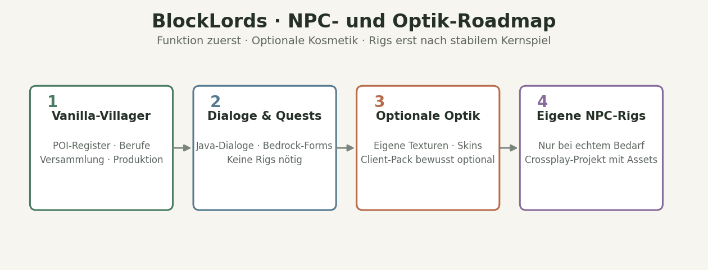

# BlockLords — Update-Recherche: Hotbar-Baumodus, Schematics, Mobian und NPCs

**Datum:** 24.11.2026  
**Kontext:** Serverwechsel von Android/Termux auf Mobian, Freigabe der nächsten Entwicklungsrunde sowie Alexanders Vorschläge zur Hotbar-Steuerung, Schematic-Suche und erweiterten NPC-Darstellung.

## Executive Summary

Die empfohlene nächste Ausbaustufe besteht aus einem **verankerten Baumodus mit optionaler Hotbar-Steuerung**, einem **validierten Sponge-Schematic-Format mit Metadaten und Lizenzakte** und einer **stufenweisen NPC-Roadmap**. Die Hotbar wird nicht einfach überschrieben: Vor Aktivierung wird das Inventar vollständig serialisiert und in SQLite gespeichert; Werkzeuge werden über PDC erkannt, gegen Bewegen und Drops gesperrt und bei Bestätigen, Abbrechen, Logout oder Tod sicher zurückgesetzt. Alle Funktionen bleiben zusätzlich über Java-/Bedrock-Menüs erreichbar. Schematics werden nicht unkontrolliert aus Katalogen gebündelt; Autor, Quelle, Lizenz, Änderungen und Hash gehören zu jedem Bauplan.

Für Mobian ist keine neue Plugin- oder Datenbankarchitektur nötig. Es handelt sich um normales Linux auf ARM64; unsere Fat-JAR enthält bereits die passenden Linux-Natives. Paper empfiehlt Java 21 bis 1.21.11 und Java 25 ab 26.1. Villager bleiben die Wirtschaftsbasis. Dialoge und Quests können später über Papers Dialog-API beziehungsweise Bedrock-Formulare entstehen, ohne eigene Körpermodelle. Optionale Texturen und Skins sind möglich, aber clientseitige Modell-Mods oder Geyser-Rigs werden bewusst nicht zur Pflicht. Eigene NPC-Rigs wären ein separates Crossplay-Projekt und kommen erst nach stabilem Kernspiel in Frage.

## 1. Hotbar-Baumodus: Empfehlung und Sicherheitsmodell

### 1.1 Spielererfahrung

Alexanders Vorschlag wird als **„Bauwerkzeug-Modus“** übernommen. Nach Auswahl eines Bauplans erscheint die Vorschau am anvisierten Boden und bleibt standardmäßig **verankert**, damit der Spieler um das Gebäude herumgehen kann. Die Hotbar enthält dann nur noch Werkzeuge: Position neu setzen, links rotieren, rechts rotieren, Anker lösen/fixieren, bestätigen und abbrechen. Die Baustellenkiste entsteht weiterhin erst nach der Bestätigung. Auf Bedrock bleiben dieselben Aktionen über Formulare erreichbar; auf Java sind Werkzeug-Items und Menüs gleichwertig.

Die Platzierung folgt damit dem bewährten Gadget-Muster aus Vorschau, Rotation, Offset und Anker. Ein dediziertes Gadget-Plugin verwendet ebenfalls Werkzeug-Interaktionen und explizite Bestätigung; die Copy-Paste-Referenz trennt Vorschau, Anker und Undo ([Building Gadget](https://www.spigotmc.org/resources/building-gadget.120091/), [Building Gadgets](https://skyfactory-4.fandom.com/wiki/Building_Gadgets)). Für BlockLords wird Undo nicht als beliebiger Sofort-Rollback implementiert. Die Preview kann beliebig verworfen werden; nach realem Bau gelten die bereits bestätigten Regeln für Pause, Abbruch und Restmaterial.

### 1.2 Sichere Inventar-Übernahme

Die Aktivierung erzeugt eine Session mit eindeutiger ID und speichert `getContents()`, Rüstung, Offhand/Extras und ausgewählten Hotbar-Slot. Paper serialisiert ItemStacks als NBT-Bytes und kann sie mit Datenkonvertierung wieder einlesen; das ist für Migrationen und Mobian robuster als ein Eigenformat ([PaperMC](https://jd.papermc.io/paper/org/bukkit/inventory/ItemStack.html)). Das Snapshot wird in SQLite gespeichert, bevor ein Werkzeug ersetzt wird. Wiederherstellung ist idempotent: Bereits geschlossene Sessions dürfen nicht nochmals Items zurückgeben.

Während der Session werden Drop, Inventory-Drag, Container-Transfer, Offhand-Swap und Pick-Block auf die Werkzeuge eingeschränkt. Paper weist darauf hin, dass Inventar-Events veränderte Slots nachträglich überschreiben können; deshalb werden Sperren im Event verhindert und nicht erst danach repariert ([PaperMC](https://jd.papermc.io/folia/26.2/org/bukkit/event/inventory/InventoryClickEvent.html)). Logout, Disconnect, Tod, Weltwechsel, Plugin-Reload und Serverstopp beenden die Session kontrolliert. Beim Tod werden Drop-Liste und Rückgabe konsistent behandelt, weil Zurückhalten ohne Entfernen aus den Drops Duplikate erzeugen kann ([PaperMC](https://jd.papermc.io/folia/26.2/org/bukkit/event/entity/PlayerDeathEvent.html)).

| Ereignis | Verbindliches Verhalten |
|---|---|
| **Bestätigen** | Vorschau schließen, Baustelle erstellen, Originalinventar genau einmal zurückgeben |
| **Abbrechen** | Keine Weltänderung, Originalinventar zurückgeben |
| **Logout/Disconnect** | Snapshot bleibt gespeichert; beim nächsten Join wird sicher wiederhergestellt |
| **Tod** | Baumodus beenden; keine Werkzeug- oder Originalitem-Duplikation in Drops |
| **Reload/Serverstopp** | Sessions schließen und persistieren; beim Start nichts doppelt zurückgeben |
| **Neue Preview** | Alte Preview nur nach sauberer Wiederherstellung ersetzen |

### 1.3 Crossplay-Regel

Bedrock verwendet unterschiedliche Touch-, Controller- und Inventarinteraktionen; Geyser übersetzt Java-Inventare, macht aber nicht jede Java-Eingabe identisch. Die Bedrock-Formulare bleiben deshalb die vollständige Alternative und sind keine Notlösung ohne Funktionen ([GeyserMC](https://geysermc.org/wiki/geyser/forms/)). Der Hotbar-Modus wird standardmäßig nur angeboten, wenn die Eingaben zuverlässig erkannt werden; andernfalls öffnet die Baustelle automatisch das Formular. Kein Spieler wird gezwungen, Inventar oder Hotbar zu übernehmen.

## 2. Schematics: Format, Quellen und Aufnahmekriterien

### 2.1 Zielformat und Metadaten

BlockLords verwendet Sponge `.schem` v2/v3. Version 3 unterstützt Blockstates, Block-Entities, Entities und Offset-Daten ([Sponge](https://github.com/SpongePowered/Schematic-Specification/blob/master/versions/schematic-3.md)). FAWE/WorldEdit rotiert das Clipboard vor dem Paste; deshalb wird jede Vorschau aus demselben transformierten Blockplan erzeugt wie der spätere Bau ([WorldEdit](https://worldedit.enginehub.org/en/latest/api/examples/clipboard/)). Es gibt keine separate Koordinatenrotation, die Türen oder Betten funktional falsch ausrichtet.

Jeder Bauplan erhält eine `blueprint.yml` mit Anker, Rotationszentrum, Eingang, Kistenposition, Job-Sites, Kosten und erlaubten Entities. Beim Import werden Größe, Blockpalette, unbekannte Blockstates, Inventare und Entities geprüft. Kisteninhalte aus Dateien werden niemals übernommen, damit keine Duplikationsquelle entsteht. Betten und Türen brauchen zusätzliche Prüfungen auf beide Teile und korrekte Ausrichtung. Die Baustellenkiste wird weiterhin vom Plugin erzeugt und nicht als gefüllte Schematic-Kiste übernommen.

### 2.2 Quellenbewertung

| Quelle | Nutzen | Verbindliche Einschränkung |
|---|---|---|
| **Eigene Baupläne** | Volle Kontrolle über Anker, Kiste, Kosten, Berufe und Blockverbrauch | Bevorzugter Start; keine externe Lizenz unsicher |
| **MineColonies-Schematics** | Offizielles Repository, Stilpacks und realistische Gebäudeprogression ([MineColonies](https://github.com/ldtteam/minecolonies-schematics)) | Das Repository enthält **GPL-3.0**; vor Bündelung Copyleft, Autoren und Änderungsnachweise klären ([Lizenz](https://raw.githubusercontent.com/ldtteam/minecolonies-schematics/master/LICENSE)) |
| **Craftmatic** | MIT-lizenziertes Werkzeug zum Parsen, Generieren, Rendern und Konvertieren von `.schem` ([Craftmatic](https://github.com/tribixbite/craftmatic)) | MIT deckt den Werkzeugcode; Texturen und Fremdbaupläne brauchen weiterhin eigene Rechteprüfung |
| **PlanetMinecraft** | Große Auswahl an herunterladbaren Schematics ([PlanetMinecraft](https://www.planetminecraft.com/projects/tag/village/?share=schematic)) | Nur einzelne Assets nach ausdrücklicher Erlaubnis; Download allein ist keine Wiederverwendungslizenz |
| **MCBuild / MineSchematic / MinecraftSchem** | Kataloge mit Vorschau, Materialien und verschiedenen Formaten ([MCBuild](https://mcbuild.org/schematics/towns/), [MineSchematic](https://mineschematic.com/c/megabuilds/villages), [MinecraftSchem](https://minecraftschem.com/)) | Katalogzugang ist keine Lizenz; jede Datei erhält eine separate Herkunftsakte |

Für jeden externen Bauplan wird `source.yml` gespeichert: Titel, Autor, Original-URL, Lizenz, Erlaubnisnachweis, Originalhash, Änderungen, Importdatum und verantwortliche Person. Ohne eindeutige Rechte bleibt die Datei nur lokale Referenz und wird nicht in GitHub-Releases verteilt. Auf diese Weise kann Alexander Baupläne aussuchen, ohne dass das Projekt später rechtlich oder technisch unübersichtlich wird.

## 3. Mobian-Wechsel

Mobian benötigt keine Android-spezifische Plugin-Logik. OpenJDK 21 und 25 sind für Linux/AArch64 verfügbar; Paper empfiehlt Java 21 bis 1.21.11 und Java 25 ab 26.1 ([Microsoft OpenJDK](https://learn.microsoft.com/en-us/java/openjdk/support), [PaperMC](https://docs.papermc.io/paper/getting-started/)). Unser Fat-JAR enthält bereits `Linux/aarch64`-SQLite-Natives; die Android-Natives bleiben für Termux erhalten, werden auf Mobian aber nicht verwendet. Die bestehende `blocklords.db` bleibt SQLite und wird nicht konvertiert.

Vor dem ersten Mobian-Start werden Java-Version, ARM64-Architektur, Schreibrechte und Backup geprüft. Danach folgt derselbe Boot- und Migrationstest wie auf dem OnePlus. FAWE, Floodgate und BlockLords bleiben separate JARs; es gibt keine Notwendigkeit, Android-/Termux-Spezialcode in das Spiel zu übernehmen. Die einzige neue Betriebsanforderung ist eine dokumentierte Java-25-Installation, wenn der Server weiterhin Paper 26.x verwendet.

## 4. Villager, NPC-Rigs, Dialoge und Quests

### 4.1 Was sinnvoll möglich ist

Vanilla-Villager bleiben die Wirtschaftsbasis, weil Registrierung, Berufe, POI-Verknüpfungen, Handel und Bewegung bereits vorhanden sind. Eigene Texturen und namensbasierte Varianten können mit Ressourcenpaketen hinzukommen. Neue Körpermodelle benötigen auf Java dagegen typischerweise OptiFine oder EMF/ETF und damit clientseitige Mods ([Human Era](https://www.curseforge.com/minecraft/texture-packs/human-era-villagers-illagers), [Hermitcraft Villagers](https://modrinth.com/resourcepack/hermitcraft-villagers)). Das wäre keine geeignete Pflicht für unsere Crossplay-Gruppe.

Citizens/Denizen können Spieler-NPCs, Skins, Wege, Gespräche und Quests liefern; BetonQuest bietet ebenfalls komplexe Gespräche, Bedingungen und Ziele ([Denizen](https://guide.denizenscript.com/guides/background/denizen-citizens.html), [BetonQuest](https://hangar.papermc.io/BetonQuest/BetonQuest)). Das ist sinnvoll, wenn BlockLords später echte Story-Kampagnen erhält. Für ein paar Dorfaufträge wäre dieser Stack jedoch überdimensioniert. Die eigene Dialoglogik kann klein bleiben und auf Papers Dialog-API beziehungsweise Floodgate-Formulare aufsetzen ([Paper Dialogs](https://docs.papermc.io/paper/dev/dialogs/)).

### 4.2 Warum eigene Rigs später kommen

Geyser besitzt seit API 2.11 eine experimentelle Custom-Entity-API. Sie benötigt zusätzlich ein Bedrock-Ressourcenpaket für Texturen und Animationen; auf Java müssen eigene Modelle über Displays oder Mods simuliert werden ([Geyser Entity API](https://geysermc.org/wiki/geyser/custom-entities/)). Display- und Interaction-Entities können serverseitig Hologramme, Markierungen und anklickbare Punkte erzeugen und sind für Baustellen und Dialoge nützlich, ersetzen aber nicht automatisch eine animierte NPC-Figur ([PaperMC](https://docs.papermc.io/paper/dev/display-entities/)).

Ein eigener Rig bedeutet deshalb zwei Darstellungswege, eigene Assets, Pack-Auslieferung, Hitbox-/Interaktionstests und Versionspflege. Das ist ein separates Projekt, kein kleines Villager-Update. Die empfohlene Reihenfolge bleibt: **Villager-Funktion → Dialoge/Quests → optionale Optik → eigene Rigs nur bei nachgewiesenem Bedarf.** Kein Spielsystem darf davon abhängen, dass ein Spieler ein Paket oder einen Mod installiert.

## 5. Empfohlener Umsetzungsplan

| Paket | Inhalt | Abgrenzung |
|---|---|---|
| **0.2.3-alpha.1** | Verankerte Preview, Hotbar-Werkzeugmodus, Inventar-Snapshot, Session-Locks, Wiederherstellung und Formular-Fallback | Keine externe Schematic-Bündelung und keine NPC-Abhängigkeit |
| **0.2.3-alpha.2** | `.schem`-Loader, Metadatenvalidator, Transformation, Herkunftsakte, erste eigene Baupläne und Kolonie-Gründungs-/UI-Basis | Keine unklaren Fremdlizenzen; keine zweite Kolonie-Wirtschaft |
| **0.2.4** | Bauhammer, manuelle Blockerkennung, atomare Reservierung und aktive Fortschrittsanzeige | Spieler und spätere NPCs teilen dieselbe Queue |
| **0.2.5** | Bauhütte und Builder-Villager mit derselben Kiste/Warteschlange | Keine eigenen Rigs nötig |
| **0.3.x** | Dialog-/Quest-Grundlagen, optionale Textur-/Skin-Pakete und spätere Bewertung von Citizens/BetonQuest | Rigs nur als eigenes, ausdrücklich freigegebenes Crossplay-Projekt |

Die Abnahme umfasst Hotbar-Logout, Tod, Weltwechsel, Reload, Serverstopp, doppelte Wiederherstellung, Java/Bedrock-Eingaben, rotierte Türen/Betten/Job-Sites, bösartige Schematic-Inventare und Mobian-ARM64. Erst wenn diese Fälle grün sind, wird die neue Bauarchitektur als stabil betrachtet. Die NPC-Roadmap bleibt bewusst modular und blockiert weder Schematics noch Baustellenkiste, Wirtschaft oder Wettkämpfe.
